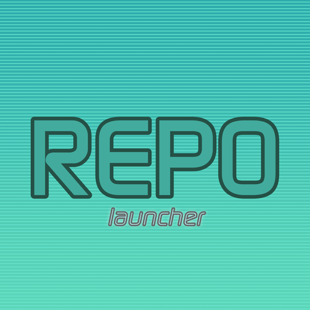

<p align="center">
  
</p>

<h1 align="center">REPO launcher</h1>

<p align="center">
  Um launcher de jogos simples para TVs LG com webOS.<br>
  Escolha uma ROM de Nintendo 64 ou Game Boy Advance com o controle remoto e jogue no RetroArch.
</p>

<p align="center">
  <a href="../../releases/latest"><b>Baixar o .ipk mais recente</b></a> · <a href="README.md">English</a> · Português
</p>

> **Status: experimental.** O pacote e os scripts foram testados em um ambiente simulado, mas não em todos os modelos de TV nem em todas as versões do webOS. Espere arestas e, por favor, conte o que você encontrar.

## Destaques

- **Uma tela, todos os jogos.** As ROMs aparecem como cartões com a etiqueta do sistema (N64 ou GBA), e você navega com as setas do controle.
- **Joga do pendrive ou de um link.** Sem pendrive? Aperte Azul, digite o link da sua própria ROM e o app baixa para você. Funciona com Dropbox, Google Drive e links https diretos, e arquivos `.zip` são descompactados.
- **Escolhe o core certo sozinho.** ROMs de N64 abrem com o Mupen64Plus-Next e as de GBA com o mGBA.
- **Auto-iniciar.** Ligue uma vez e o app abre o último jogo depois de uma contagem de 3 segundos.
- **Feito para o controle remoto.** Tudo está nas setas, no OK, no Voltar e nas quatro teclas coloridas.

## Aviso sobre ROMs

**Este projeto não inclui, distribui, hospeda nem indica onde baixar ROMs, BIOS, jogos ou qualquer material protegido por direitos autorais.**

- Use apenas ROMs que você obteve legalmente, por exemplo extraídas de cartuchos que você possui.
- Não peça ROMs nas issues e não envie links para elas. Esses pedidos serão ignorados ou removidos.
- As leis sobre cópias de segurança de jogos variam de país para país. Cabe a você conhecer e cumprir a lei local.

## Requisitos

| Requisito | Observações |
|---|---|
| TV LG com webOS | Com root. O launcher precisa de root para achar as ROMs e abrir o RetroArch, e usa o serviço de comandos como root que as ferramentas de homebrew do webOS instalam quando a TV recebe root |
| [RetroArch para webOS](https://repo.webosbrew.org/apps/com.retroarch.webos) | Id do app `com.retroarch.webos` |
| Cores libretro | `mupen64plus_next_libretro.so` (N64) e `mgba_libretro.so` (GBA). Instale pelo RetroArch: **Load Core → Download a Core**. Não estão incluídos |
| Suas ROMs | Em um pendrive (FAT32 ou exFAT é o mais seguro) ou baixadas por link (veja abaixo) |

## Instalação

1. Abra a [página de Releases](../../releases/latest) e baixe o arquivo `.ipk`.
2. Instale na TV com o [webOS Dev Manager](https://github.com/webosbrew/dev-manager-desktop) (arraste o arquivo e clique em Install) ou pelo terminal:

   ```sh
   ares-install com.user.n64usblauncher_1.3.0_all.ipk -d <sua-tv>
   ```

3. Abra o **REPO launcher** na lista de apps da TV.

## Uso

Plugue um pendrive (ou baixe uma ROM, veja abaixo), abra o app, escolha um jogo e aperte OK.

| Tecla do controle remoto | Ação |
|---|---|
| Setas | Mover entre os jogos |
| OK | Jogar |
| Vermelho | Procurar ROMs de novo |
| Verde | Abrir o RetroArch sem ROM |
| Amarelo | Ligar ou desligar o auto-iniciar |
| Azul | Baixar uma ROM por link |
| Voltar | Sair |

### Baixar uma ROM por link

Aperte **Azul**, digite o link público da **sua própria** ROM e aperte OK. O progresso aparece na tela, e a ROM entra na lista quando termina.

- **Dropbox:** compartilhe o arquivo ("qualquer pessoa com o link") e use esse link. O app o transforma em download direto sozinho.
- **Google Drive:** deixe o arquivo como "qualquer pessoa com o link" e use o link de compartilhamento.
- **Arquivos .zip:** são descompactados e a ROM de dentro é mantida (precisa do `unzip` na TV).
- **Digitar na TV é lento.** Encurte o link antes, com um encurtador como o tinyurl, e digite o link curto. Links curtos são seguidos automaticamente.
- Os downloads ficam em `/media/developer/roms`. O app confere o conteúdo do arquivo para distinguir ROMs de N64 e GBA e recusa qualquer outra coisa, inclusive páginas web devolvidas por links privados.

O link precisa começar com `https://`.

### Auto-iniciar

Aperte **Amarelo** uma vez para ligar. Da próxima vez que abrir o app, ele inicia o último jogo depois de 3 segundos. Aperte qualquer tecla durante a contagem para cancelar e ver a lista.

## Configuração

Se o launcher não achar um core sozinho, defina o caminho em `n64launcher.conf`, dentro da pasta do app:

```sh
CORE_PATH_N64="/caminho/para/mupen64plus_next_libretro.so"
CORE_PATH_GBA="/caminho/para/mgba_libretro.so"
```

## Se algo falhar

| Problema | O que tentar |
|---|---|
| Mensagem "core não encontrado" | Instale o core pelo RetroArch (Load Core → Download a Core) ou defina o caminho em `n64launcher.conf` |
| Nenhuma ROM aparece | Confira o formato do pendrive e se os arquivos terminam em `.z64`, `.n64`, `.v64` ou `.gba`. Aperte Vermelho para procurar de novo |
| Mensagem "não consegui rodar comandos" | A TV não tem root, ou o serviço de comandos como root não está rodando. Use a tecla Verde para abrir o RetroArch direto |
| O download falha ou diz "página web" | O link não é público. Deixe o compartilhamento como "qualquer pessoa com o link" |
| Tela preta depois de iniciar | Leia `/tmp/n64-usb-launcher.log` por SSH e abra uma issue com o conteúdo |

## Feedback

Relatos de teste são muito bem-vindos, principalmente o modelo da TV e a versão do webOS em que funcionou ou falhou. Abra uma issue com esses dados. Não inclua ROMs, BIOS nem links para elas.

O REPO launcher executa comandos como root na sua TV, então instale apenas a partir da página de Releases deste repositório.

## Riscos do root

Obter root em uma TV pode anular a garantia, e atualizações de firmware podem remover o acesso. Este projeto não oferece suporte para o processo de root.

## Créditos

A emulação é feita pelo [RetroArch](https://www.retroarch.com/) e pelos cores libretro Mupen64Plus-Next e mGBA, que são projetos separados, com licenças próprias, e não fazem parte deste repositório.

## Marcas e afiliação

Este é um projeto independente e **não é afiliado, patrocinado nem endossado** por Nintendo, LG Electronics, libretro/RetroArch ou pelo webOS Homebrew Project. Todos os nomes e marcas pertencem aos seus respectivos donos e são citados apenas para identificar compatibilidade.

## Licença

Copyright (c) 2026 ruubr337. Todos os direitos reservados.

Você pode instalar e usar este app para fins pessoais e não comerciais. Não é permitido redistribuir, modificar ou vender sem autorização por escrito. O software é fornecido "como está", sem garantias.

Este não é um software de código aberto.
